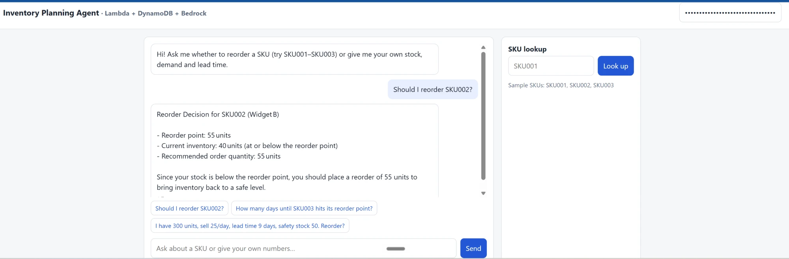

# Inventory Planning Agent: serverless AWS edition

**Author:** Vishal Gupta · based on the Inventory Planning Agent by Shivank Agrawal (`week3/inventory-agent-aws`)

An AI reorder assistant: ask *"Should I reorder SKU002?"* and a LangChain tool-calling agent looks the SKU up in
DynamoDB, runs a reorder-point calculator and answers in plain English. This edition replaces the
instructor's always-on ECS Fargate + ALB + EFS stack (about $40-60/month) with a serverless stack that costs
**$0 when idle** and stays inside the AWS Free Tier for a demo.

```
Browser ──HTTPS──▶ Lambda Function URL (public)   /        → static index.html
                                                  /api/*   → X-API-Key required
                                                 Python 3.13 · arm64 · FastAPI + Mangum
                                                 LangChain 1.x create_agent, 2 tools
                                                   ├──▶ Amazon Bedrock (OpenAI-compatible "Mantle" endpoint)
                                                   │      openai.gpt-oss-120b, short-term token signed by the Lambda role
                                                   ├──▶ DynamoDB  inventory  (PK sku_id)
                                                   └──▶ DynamoDB  sessions   (PK session_id, SK ts, TTL 30 days)
SSM Parameter Store: X-API-Key (SecureString) · CloudWatch Logs (7 days) + error alarm · AWS Budgets
```

An optional `cloudfront` mode puts CloudFront in front (private S3 for the page, IAM-only Function URL signed by
CloudFront OAC, security headers). See *Two edge modes* below.

## Screenshot

The live app on AWS (Lambda Function URL, us-east-2): the agent looks up SKU002 in DynamoDB, runs the
reorder calculator and recommends ordering 55 units.



## What is different from the Fargate version

| Concern | Fargate edition | This edition |
|---|---|---|
| Compute | 2 Fargate tasks behind an ALB | 1 Lambda (arm64), Function URL behind CloudFront |
| Database | SQLite file on EFS | DynamoDB on-demand, TTL on chat logs |
| UI | Gradio container | One static HTML page on S3 |
| LLM credentials | OpenAI key in SSM | **No long-lived key**: Lambda signs a short-term Bedrock token with its IAM role and rotates it every 30 min |
| Network | VPC, subnets, security groups, Cloud Map | None needed |
| Idle cost | ~$40-60/month | $0 |
| Agent framework | LangChain 0.3 `AgentExecutor` | LangChain 1.x `create_agent` (LangGraph) |

## Layout

| Path | What |
|---|---|
| `backend/api.py` | FastAPI routes under `/api` + Mangum Lambda handler |
| `backend/agent.py` | Agent, system prompt, tool trace |
| `backend/db_client.py` | DynamoDB access (same functions as the SQLite version) |
| `backend/settings.py` | Config, role-signed Bedrock token, API key from SSM |
| `backend/tools/` | `lookup_inventory`, `calculate_reorder` (unchanged) |
| `frontend/index.html` | Chat + SKU lookup page (no build step) |
| `template.yaml` | SAM template: DynamoDB, Lambda + URL, S3, CloudFront + OACs, alarm, budget |
| `scripts/deploy.ps1` | Build, package, deploy, upload UI, smoke test (`-Destroy` to tear down) |
| `scripts/smoke_model.py` | Proves the Bedrock credentials + tool calling |
| `scripts/try_agent_local.py` | Real agent + in-memory DynamoDB (moto) |
| `scripts/smoke_deploy.py` | End-to-end test through CloudFront |
| `tests/` | Offline tests (moto, LLM stubbed) |

## Run locally

```powershell
py -3.13 -m venv .venv
.venv\Scripts\pip install -r requirements-dev.txt
copy .env.example .env        # fill in OPENAI_PROJECT_ID, API_KEY
aws login                     # local runs sign Bedrock tokens from your AWS login
.venv\Scripts\python -m pytest -q
.venv\Scripts\python scripts\try_agent_local.py "Should I reorder SKU002?"
```

## Deploy (Windows PowerShell, no SAM CLI or Docker needed)

```powershell
aws login
.\scripts\deploy.ps1                # region us-east-2 by default
```

The script stores the API key in SSM, builds Linux arm64 wheels with pip, packages to an S3 artifact
bucket, deploys the stack, uploads the UI, invalidates CloudFront and runs the smoke test. It prints the app URL.
Open it, paste your `API_KEY` into the top-right box, and ask away.

Tear down: `.\scripts\deploy.ps1 -Destroy`

### Two edge modes

| `-EdgeMode` | What fronts the app | When to use |
|---|---|---|
| `function-url` (default, deployed) | Public Lambda Function URL serves the page **and** the API; `/api/*` requires `X-API-Key` | Simplest; works on new accounts that CloudFront has not verified yet |
| `cloudfront` | CloudFront → private S3 UI + IAM-only Function URL (OAC), security headers | Needs an account allowed to create CloudFront distributions (new accounts get *"Your account must be verified..."* until AWS Support lifts it) |

```powershell
.\scripts\deploy.ps1                          # function-url (default)
.\scripts\deploy.ps1 -EdgeMode cloudfront     # optional, once the account can create CloudFront distributions
```

## Live deployment evidence (us-east-2, function-url mode)

From `docs/evidence/`:

* `smoke-test.txt`: UI 200, health 200, wrong key 403, inventory 200, chat 200 in 2.3 s with the correct answer
  (SKU002: reorder point 55, order 55 units). The Lambda signed its own Bedrock token, so no Bedrock key is stored anywhere.
* `lambda-report-lines.txt`: cold start 2.9 s init, warm requests 15-95 ms, chat turn 1.5 s, peak memory 218 MB.
* `stack-resources.txt`: 10 resources: Lambda + URL, IAM role, 2 DynamoDB tables, log group, alarm, budget, 2 permissions.
* `live-chat.webp`: the chat UI answering "Should I reorder SKU002?" against the live deployment.
* CloudWatch: 0 errors.

## Notes

* Requests from the browser to `/api/*` include `x-amz-content-sha256` (SHA-256 of the body). CloudFront OAC
  needs it to sign POST requests to a Lambda Function URL.
* Reserved concurrency (cost guard) is set to 5 only when the account limit allows it; new accounts have a
  limit of 10 and cannot reserve any.
* Region: Bedrock tokens are region-scoped, so the stack, `OPENAI_BASE_URL` and the project must be in the same region.
